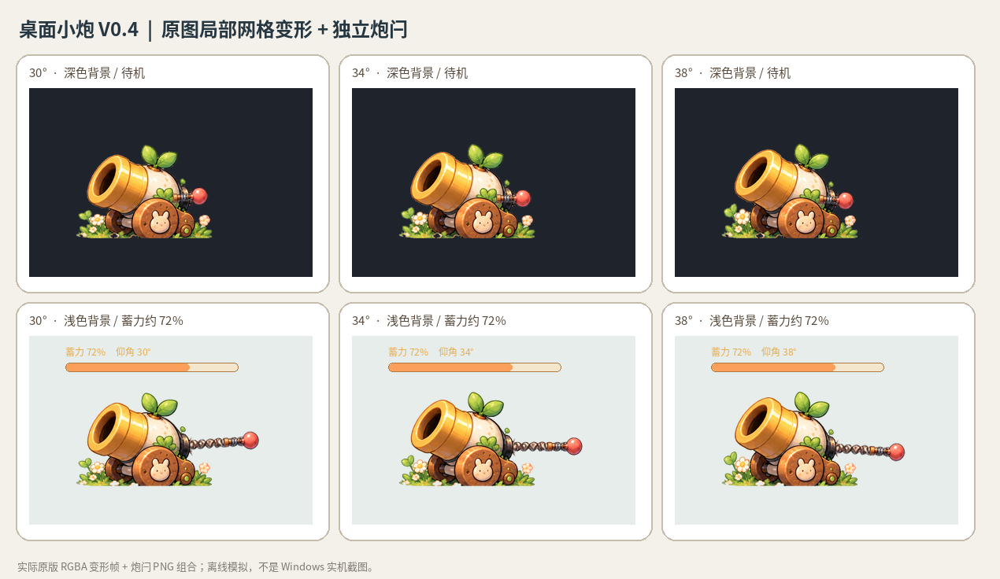

# 桌面小炮 V0.4.1 — 原版美术 + 局部网格微动 + 弹道对齐

**本版已把经过视觉验证的 30°～38° 局部网格变形方案接入 Tauri 工程。** 基于 V0.1.1 已认可的原始 `cannon_base.png`，没有采用画风退步的 V0.3 矢量重绘，也没有使用 V0.2 的切割炮管或固定遮罩补丁。



> 图为实际网格帧、弹簧和红球图片的**离线合成模拟**，不是 Windows/WebView2 运行截图。真实透明桌面覆盖仍需 Windows 实机验收。


## V0.4.1 弹道虚线对齐修复

不修改原画、网格动画帧和 Tauri 双窗口结构，只针对预测轨迹与实际发射链路做修正。

- 预测与实弹统一用 **1/120 秒固定步长**，渲染频率不再改变物理轨迹。
- 预测从实际炮口坐标开始（第一个点是发射位置），并在第一次撞击处结束；实弹仍会继续反弹。
- 每次新瞄准都重新请求当前窗口位置；不能短暂沿用移动前的位置。
- 松开鼠标时采样最终指针坐标，不依赖恰好收到最后一个 `pointermove`。
- 静止瞄准时缓存预览数据，避免 Canvas 每帧重复推算。

详情：[docs/TRAJECTORY_ALIGNMENT_V041.md](docs/TRAJECTORY_ALIGNMENT_V041.md)。
**回归测试 26/26 通过；Windows 实机瞄准对齐效果仍需验证。**

## 操作

- **拖动炮身/木轮**：移动整个小炮窗口（保留 V0.1.1 功能）。
- **向右拖动红色炮闩**：蓄力，0～90 CSS px → 0～100%。
- **同时上下拖动**：在 **30°～38°** 范围内微调俯仰，**每 0.5° 一帧**；向下移动炮尾 → 炮口抬高。
- **松手**：从位移场计算出的新炮口位置按显示角度发射；预测弹道和飞行使用同一固定步长，并且只预测首次撞击前的路径。
- **Esc**：取消当前操作，恢复这次拖动前的俯仰角；松手正常发射后保留角度。

## 为什么改用这种方式

早期把原图切分再旋转，在炮管下方出现裂缝、台阶、重贴；SVG 重绘破坏了原版画风。本版保留整张原画，对炮口及炮身施加**平滑位移场**，让草地和木轮附近影响尽量小。**这是一种小角度假运动，不是物理准确的机械旋转**；因此只开放目前视觉检查较好的 ±4°。

## 项目核心文档（可复用到其他项目）

**[docs/LOCAL_MESH_WARP.md](docs/LOCAL_MESH_WARP.md)**：算法公式、控制权重、预乘 Alpha、逆向重采样、坐标映射、性能权衡、植物/宠物动画复用指南及不适用场景。新项目可直接复制 `scripts/generate_mesh_frames.py`、`mesh_rig.json` 并重调影响区域。

## 开发、预览、测试

运行条件：Windows，Node.js 20+；原生桌面需要 Tauri 2/Rust MSVC + MSVC Build Tools + WebView2。

```powershell
# 浏览器模拟桌面：无需 Rust，先看互动效果
预览启动.bat
# 或 npm run preview，访问 http://127.0.0.1:1420/preview.html

# Tauri 原生双窗口（需 Rust 工具链）
Windows开发启动.bat

# 自动化回归
npm test

# 离线视觉数据测试（需要 numpy、opencv-python、Pillow）
python scripts/validate_mesh.py

# 重新生成帧，使用相同源码和参数可重复
python scripts/generate_mesh_frames.py

# 生成工程离线合成对照图
python scripts/render_mesh_preview.py
```

静态源码和 PNG 已验证；当前 Linux 环境无 Rust/Cargo，且 Chromium 运行截图受策略/沙箱限制，因此**没有 Windows EXE 编译通过或真实跨应用置顶/鼠标穿透的验收结论**。

## 关键文件

```text
web/assets/cannon_base.png             原版高质量原画（始终保留）
web/assets/mesh/mesh_rig.json           模型参数、角度及影响区配置
web/assets/mesh/frames/pitch_00..16.png 17 张预计算 RGBA 帧（34° 为原图）
web/js/mesh-warp.mjs                    位移场、帧索引、炮口/炮尾映射
web/js/aim.mjs                          二维拉闩与角度量化
web/js/geometry.mjs                     动态炮口、位置换算
web/js/cannon.mjs                       图帧选取、炮闩移动、事件发送
web/js/overlay.mjs                      桌面炮弹、预测弹道与粒子
scripts/generate_mesh_frames.py        通用帧生成器
scripts/validate_mesh.py               RGBA/原图/草地保护检查
docs/LOCAL_MESH_WARP.md                 可复用技术文档
docs/v04_mesh_interaction_preview.png   实际 PNG 工程离线合成预览
```

本版采用 Tauri 2 原生透明双窗口，沿用贴贴项目的技术栈；不改动贴贴原工程。V0.1.1 仍应保留为稳定回退版本。
