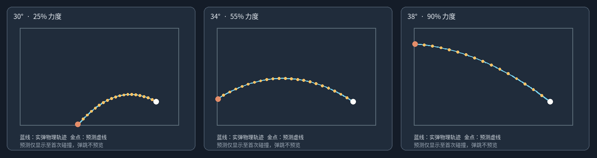

# 桌面小炮 V0.4.1 — 预测虚线与真实炮弹对齐修复

## 背景

V0.4 Windows 实机反馈：小炮原画和微动效果满意，但蓄力时虚线在某些情况下与炮弹运动不一致。
旧代码虽然都调用 `stepProjectile()`，但**预测**每次用固定 45 ms 作为积分区间，**实弹**每次使用实际 RAF 帧间隔。`stepProjectile` 采用半隐式欧拉更新，并且对每次调用中不足 1/120s 的尾步进行补算。因此不同刷新率和不同帧间隔会造成数值偏差。首次碰撞后误差更明显。

另一个问题是：瞄准开始前存在 `layout` 缓存。用户移动小炮后，异步获取窗口最新位置期间，预测可能短暂使用旧的炮口坐标。松手 `pointerup` 还可能比最后一个 `pointermove` 更晚，造成展示力度和实际力度不同。

## 这次的修正

1. `physics.mjs` 新增 `advanceProjectileFrame()`：逐个累积 RAF 的真实 `dt`，按完整的 `PHYSICS.maxStep` (1/120 秒) 推进，不把每帧的不足量作为小尾步；剩余时间留到下一帧。
2. `trajectory.mjs` 使用同样的固定物理步长，每隔若干步取一个轨迹点，**第一点就是 `createProjectile()` 的原始发射位置**。
3. `cannon.mjs` 每次开始瞄准时先清除旧布局缓存，重新请求 `getLayout()` 后才发虚线预览事件。异步结果受瞄准序列号保护。
4. `cannon.mjs` 在指针松开时最后采样一次力度/角度，确保最后的发射信息不是上一个 `pointermove` 的旧值。
5. `overlay.mjs` 仅在力度、仰角、发射点或屏幕边界变化时重新计算轨迹，避免持续重复计算。

## 坐标和时间约定

- 物理和虚线都使用 **CSS 像素**，屏幕高 DPI 在 Canvas 渲染阶段才缩放，不参与物理坐标。
- `muzzleOnOverlay(layout, angle)` 给出本次发射与预测共用的起点。
- 当前 `shotVelocity(power, angle)` 给出两者相同的初速度。
- `stepProjectile` 为唯一的运动与碰撞积分器。
- 虚线只到**第一次撞击**，不是对弹跳后的多次轨迹预测。撞击后的真实弹跳仍受能量损失和摩擦影响，属于预期区别。
- 实弹的物理位置是固定 120Hz 离散步，视觉上在特殊高刷新率屏幕上可能有不到一步的时间量化；这与轨迹方向错误不同。

## 自动化验收

- 30°/34°/38°，弱、中、强蓄力，左右边界/顶边界场景。
- 30、60、120、144Hz 和不规则渲染帧间隔下同一累计时间的实际物理位置一致。
- 预测采样点与真实逐步积分的坐标一致；撞击点为最后一个预测点。
- 移动小炮后旧布局不得用于新瞄准。
- 抬手位置改变时必须用最终坐标发射。

运行：`npm test`；素材验收：`npm run test:assets`（需要 OpenCV/Numpy/Pillow）。

## Windows 实机验收清单（仍需用户侧检查）

1. 不移动窗口时，分别在 30°、34°、38°、20%/60%/100% 力度下缓慢蓄力并发射，虚线与炮弹应沿相同轨迹直到首次碰撞。
2. 将小炮拖到屏幕左边、上边，再拖回右下角：每次开始蓄力，不应出现虚线瞬间停留在旧窗口位置。
3. 在拖动红球过程中快速移动/抬手，最终力度与出射方向应和抬手位置相符。
4. 从 60Hz 切换到 120/144Hz（如果可用）重复比较；若有高 DPI 显示，分别在 100%/150% 缩放下测试。
5. 虚线抵达屏幕边缘时停止；炮弹撞击后继续反弹属正常，不是虚线错位。
6. 特别关注显示器顶部和 Windows 任务栏附近的边界；如果偏差只在某个 DPI 或副屏出现，需另排查窗口坐标和显示器缩放。

**已验证：** JS 单元/集成和离线素材测试。**尚未验证：** Tauri 原生 Release/Windows WebView2 的实际显示和跨应用鼠标穿透，本包不包含编译完成的 EXE。

## 离线轨迹对照图

此图由 V0.4.1 **实际 JavaScript 预测与物理函数**生成数据，再用绘图库叠加显示。不是 Windows 运行截图。白色点为起点、橙色点为撞击处；预测点与实际物理路径在首次撞击之前重合。它验证数值一致性，不代替 Windows 渲染与多显示器 DPI 验收。
